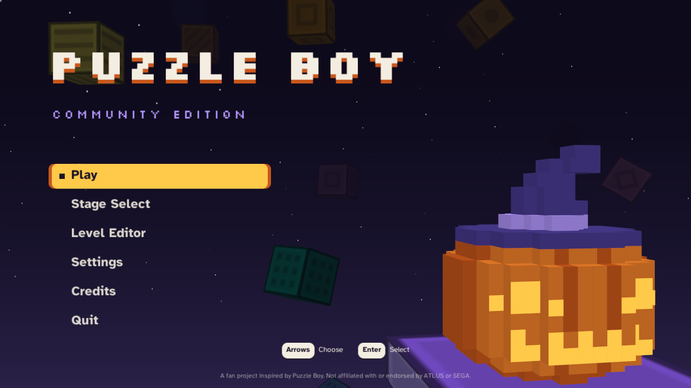
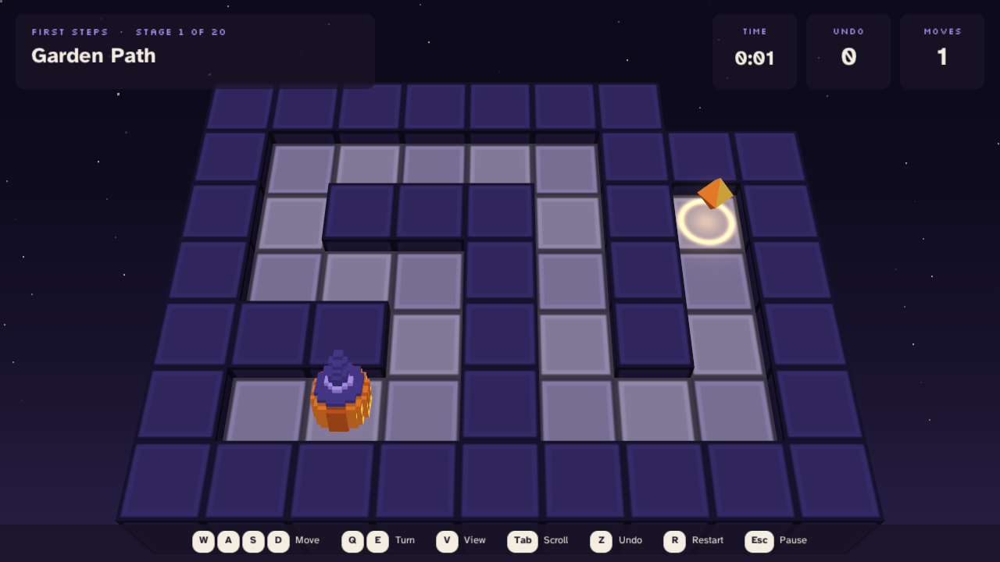
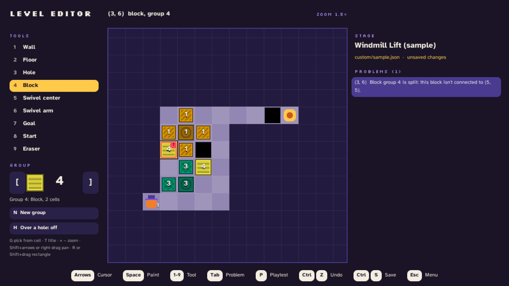

<h1 align="center">
  
</h1>

<p align="center"><b>The Nocturne Puzzle Boy minigame, expanded. Best with your own copy (the Classic theme); plays out of the box with the bundled Default theme.</b></p>

<p align="center">
  
  <br><em>The Classic Nocturne theme, rendered from a local copy of the game.</em>
</p>

<table>
  <tr>
    <td align="center" width="33%">
      <a href="https://github.com/user-attachments/assets/11165754-4eb1-4a77-a3b0-17b58a949b9f"></a>
      <br><sub>Title, with the original Jack-o'-Lantern</sub>
    </td>
    <td align="center" width="33%">
      <a href="https://github.com/user-attachments/assets/0f1ba580-9b60-4e1c-a67c-9238a8fd1a57"></a>
      <br><sub>Stage select and the Classic campaigns</sub>
    </td>
    <td align="center" width="33%">
      <a href="https://github.com/user-attachments/assets/ffc31e75-c783-4a6c-91dd-66e280bc535f"></a>
      <br><sub>In play: the original HUD and prompts</sub>
    </td>
  </tr>
  <tr>
    <td align="center" width="33%">
      <a href="https://github.com/user-attachments/assets/6e52dbd0-fab7-4a44-acf7-2d1e32ff1953"></a>
      <br><sub>The original menu, with your moves and time</sub>
    </td>
    <td align="center" width="33%">
      <a href="https://github.com/user-attachments/assets/95e01a59-8409-4547-8413-b7981b9f6228"></a>
      <br><sub>A bonus stage the original never plays</sub>
    </td>
    <td align="center" width="33%">
      <a href="https://github.com/user-attachments/assets/fe93d4fb-9c7a-478c-8b4b-b05d1cc33963"></a>
      <br><sub>Every control, in the original's style</sub>
    </td>
  </tr>
</table>

<p align="center"><sub>Classic theme images are rendered from a local copy of the game and hosted as uploads; none of it is in this repository or its downloads.</sub></p>

Push blocks, turn swivels and fill holes to reach the goal, with the minigame's rules, a campaign of new stages, a level editor and level packs. If you own *Shin Megami Tensei III Nocturne HD Remaster*, import it once and every stage plays in the original's look and sound: its board, its Jack-o'-Lantern, its camera, its music. Without it, the Default theme plays the same stages with Pixel Jack, a pumpkin in a witch's hat, and art and sound made for this game. It needs no Steam and no network either way.

> **Status:** [0.1.0](https://github.com/hazeliscoding/puzzle-boy-community/releases/tag/v0.1.0) is out for Windows, Linux and macOS. The Nocturne-styled interface for the Classic theme comes in the next release. See [ROADMAP.md](ROADMAP.md) and [CHANGELOG.md](CHANGELOG.md).

<p align="center">
  
  
  
  <br><em>The Default theme, which plays out of the box: captured from the app.</em>
</p>

## Features

- Twenty original stages, from a first walk to the goal through blocks, holes, swivels and a team of up to three Jacks, each with a hint on the help screen.
- Push blocks, turn swivels and fill holes with the same rules as the original, from puzzle-boy-engine.
- Stage select with cleared, new and locked stages, your best moves and time, and a preview of each stage.
- A level editor: paint a stage, see every problem by its cell, playtest it, ask the solver, and keep it under My Stages.
- Level packs: export your stages as a `.zip` to share, and import other players' packs, each checked before it's added. See [docs/packs.md](docs/packs.md).
- Progress and settings saved on your computer, with a backup if the file is ever damaged. No account, no network.
- Settings for fullscreen, window size, UI scale, music and sound volume, mute, reduced motion and high contrast.
- Keyboard, mouse and controller. Undo, restart, a turning camera, an overhead view and the original's scroll mode.
- The Default theme's graphics are drawn and its music synthesized in code: nothing to download after you unpack it.
- The Classic Nocturne theme, from your own copy, for every stage: the campaign, your own, imported packs, and the original's 20 stages and 23 unused bonus stages.

It plays on [puzzle-boy-engine](https://github.com/hazeliscoding/puzzle-boy-engine), the rules shared with [puzzle-boy](https://github.com/hazeliscoding/puzzle-boy), a preservation port that reads the original stages from your own copy of Nocturne.

## The Classic Nocturne theme, from your own copy

Import once: Settings → Classic Nocturne → Import from My Steam Install (or Import from a Folder or Zip, with the folder that holds `smt3hd.exe`) copies the eight bundles the theme reads, about 120 MB, into a classic pack in your data folder, and checks each file's hash whenever it's used. The Theme setting is Auto: with a pack it plays the Classic theme, without one the Default theme; Classic and Default fix it. The whole interface follows: in play the original's HUD, controls bar, menu and rules page, and on Community's own screens the original's font, windows, cursor and key prompts, with the Jack-o'-Lantern on the title. Stage select also adds Classic: Original 20, the original's stages in its order, and Classic: Bonus, 23 unused stages from the game that a solution clears. The Manikin Kid and the original's dialogue aren't part of it.

Export My Classic Pack writes one zip you can import on your other computers. It's made from your own copy, for your own computers: don't share it. Nothing from Nocturne ships with this game or is downloaded, and the game never looks for Nocturne unless you ask. Remove Classic Pack deletes the pack again, keeping your progress. From a command line, `--import-classic <game folder or pack zip>` and `--export-classic` do the same.

Screenshots committed to this repo use the Default theme only; the Classic images at the top are hosted uploads.

## Download and play

Download the archive for your system from [Releases](https://github.com/hazeliscoding/puzzle-boy-community/releases), unpack it anywhere and run `PuzzleBoyCommunity` (`PuzzleBoyCommunity.exe` on Windows). [Install and troubleshooting](docs/install-and-troubleshooting.md) covers each system, the security prompts for unsigned builds, where your saves live, the Classic theme and how to report a bug. Coming from puzzle-boy v0.2.0's bonus stages? See [docs/migration.md](docs/migration.md).

## Build

```bash
git clone --recurse-submodules https://github.com/hazeliscoding/puzzle-boy-community.git
cd puzzle-boy-community
dotnet run --project src/PuzzleBoy.Community
```

[docs/contributing.md](docs/contributing.md) covers the engine pin, adding a stage and the asset rules.

## License

The code is licensed under [Apache-2.0](LICENSE). The fonts are under the SIL Open Font License 1.1; [content/ASSET_CREDITS.md](content/ASSET_CREDITS.md) credits every file in `content/`. The libraries every build ships (MonoGame, SDL2, OpenAL Soft, FontStashSharp and others) keep their own licenses, collected in [THIRD_PARTY_NOTICES.txt](THIRD_PARTY_NOTICES.txt), which is copied beside the game.

*Shin Megami Tensei*, *Nocturne* and *Puzzle Boy* are trademarks of ATLUS and SEGA. This is an independent fan project. It is not affiliated with or endorsed by either company, and its downloads contain no ATLUS or SEGA assets: the Classic theme reads them from your own copy.
